 

  

## About

I'm an AI/ML engineer focused on turning complex data into **production-ready intelligent systems**, from credit-risk pipelines on 1M+ records to RAG systems that make internal knowledge searchable. I work where **mathematical rigor meets engineering pragmatism**: every model is shipped for scale, reliability, and measurable business value.

## Projects

<table>
  <tr>
    <td width="50%" valign="top">
      <h3>Loan Default Prediction Engine</h3>
      <code>classification</code>
      
End-to-end credit-risk pipeline reaching <b>98% accuracy</b>: feature engineering, SMOTE for class imbalance, and a full XGBoost vs Random Forest vs Logistic Regression comparison.

      <a href="https://zainul-loan-default-prediction.streamlit.app/"><b>Live demo</b></a> · <a href="https://github.com/zainulabedeen589/Loan-Default-Prediction-System"><b>Code</b></a>
    </td>
    <td width="50%" valign="top">
      <h3>Airline Satisfaction Predictor</h3>
      <code>classification</code>
      
Classifies satisfaction from <b>25+ passenger-experience features</b>, reaching a <b>96% F1-score</b> with ensemble methods and full EDA.

      <a href="https://github.com/zainulabedeen589/AIRLINE-COSTUMER-SETISFECTION-PREDICTION"><b>Code</b></a>
    </td>
  </tr>
  <tr>
    <td colspan="2" valign="top">
      <h3>EvalMatrics</h3>
      <code>evaluation tooling</code>
      
Upload true and predicted values in Excel and instantly get <b>every relevant ML metric</b> (regression, binary, multi-class), plus a formatted PDF report with a full appendix of definitions and formulas.

      <a href="https://zainulevalmatrics.netlify.app/"><b>Live demo</b></a>
    </td>
  </tr>
</table>

## Skills

<b>Full list</b>

 

| | |
|---|---|
| **Languages** | `Python` `SQL` |
| **ML / DL frameworks** | `Scikit-learn` `XGBoost` `LightGBM` |
| **Data & visualization** | `Pandas` `NumPy` `Matplotlib` `Seaborn` `Plotly` `Feature engineering` |
| **NLP & generative AI** | `Hugging Face` `LangChain` `spaCy` `NLTK` `OpenAI API` `RAG pipelines` |
| **DevOps & cloud** | `MLflow` `Streamlit` `FastAPI` |
| **Databases & storage** | `PostgreSQL` `MySQL` `ChromaDB` `SQLite` |

## Experience & Education

**AI/ML Engineer Intern**, Euron · `April 2026 — Present`  
Designing and deploying end-to-end ML pipelines for credit-risk models processing 1M+ records, deployed via Streamlit.

**Bachelor of Computer Application**, IFTM University, Moradabad, U.P., India · `2024 — 2027`  
Strong foundation in algorithms, statistics, and probability. 15+ ML/AI projects completed independently; studied CNNs, RNNs and Transformers, with published research on NLP applications.

<b>Certifications (6)</b>

 

| Certification | Issuer | Year | |
|---|---|:---:|:---:|
| Google Advanced Data Analytics | Google / Coursera | 2025 | [Verify →](https://www.coursera.org/account/accomplishments/professional-cert/OGB8GJYW9R0F) |
| Meta Data Analyst | Meta / Coursera | 2025 | [Verify →](https://www.coursera.org/account/accomplishments/professional-cert/753NZP2E6X7C) |
| Full Stack Data Science | Euron | 2025 | [Verify →](https://euron.one/certificate/b1e0ee78-e973-43d6-812e-8c9b1c5cb9dc) |
| SQL Masters | Euron | 2025 | [Verify →](https://euron.one/certificate/34dcabf3-2225-45c2-a2d3-2cb280ecfce7) |
| Machine Learning in Python | 365 Data Science | 2025 | [Verify →](https://learn.365datascience.com/certificates/CC-28DB538D67/) |
| Power BI | 365 Data Science | 2025 | [Verify →](https://learn.365datascience.com/certificates/CC-C91629DC24/) |

### Let's turn your data into intelligence.

<code>© 2026 Zainul Abedeen — built with data and a lot of gradient math.</code>

